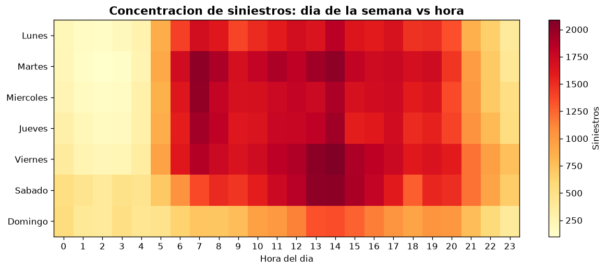
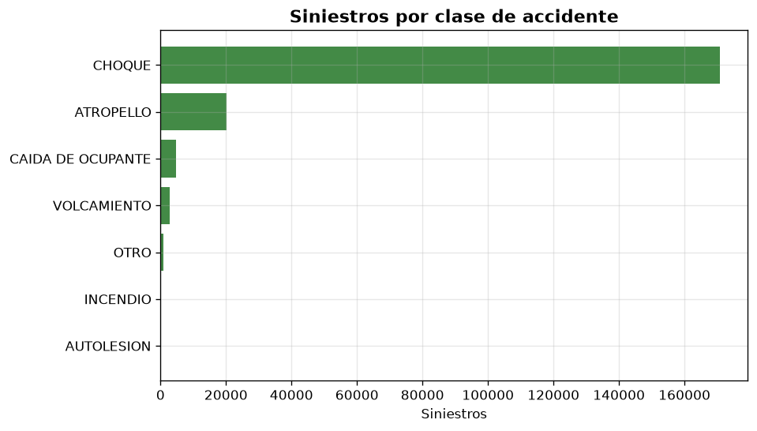

# Seguridad Vial en Bogota: analitica end-to-end con SQL, Python y Power BI

Caso de negocio de analitica de datos que integra **SQL**, **Python** y **Power BI**
sobre datos publicos de la **Alcaldia Mayor de Bogota** para priorizar
intervenciones de seguridad vial y campanas de prevencion.

## 1. Caso de negocio

**Cliente (persona):** Secretaria Distrital de Movilidad / aseguradora de
movilidad que necesita decidir **donde** y **cuando** focalizar recursos.

**Pregunta de negocio:** los siniestros viales de Bogota ocurren de forma
desigual en el territorio y en el tiempo. Un presupuesto de prevencion limitado
deberia asignarse a las localidades, corredores y franjas horarias con mayor
**volumen** y mayor **severidad**.

**Objetivo:** construir un pipeline reproducible (dato crudo -> modelo analitico
-> KPIs -> tablero) que responda:

1. Como evoluciona la siniestralidad por anio y gravedad.
2. Que localidades concentran mas siniestros (volumen) y cual es el riesgo
   relativo por habitante (tasa por 100.000 hab.).
3. En que franjas horarias y dias de la semana se concentran los eventos.
4. Cuales son los puntos criticos (corredores/direcciones) a intervenir.
5. Donde la severidad (lesionados/muertos) es mas alta.

## 2. Fuentes de datos (datos abiertos de Bogota)

| Dataset | Entidad | Periodo | Registros | Licencia | Enlace |
|---|---|---|---|---|---|
| Historico Siniestros Bogota D.C. | Secretaria Distrital de Movilidad (SDM) | 2015-2021 | 199.146 | CC-BY-4.0 | [portal](https://datosabiertos.bogota.gov.co/dataset/historico-siniestros-bogota-d-c) |
| Poblacion en Bogota D.C. por Localidad (2005-2035) | Secretaria Distrital de Salud (SDS) | 2005-2035 | 651 (agregada) | CC-BY-4.0 | [portal](https://datosabiertos.bogota.gov.co/dataset/poblacion-en-bogota-d-c-2005-2035) |

Los datos **no se versionan** en el repositorio: el pipeline los descarga
automaticamente desde el portal de datos abiertos.

## 3. Arquitectura de la solucion

```
                    +-------------------+
                    |  Portal de datos  |
                    |  abiertos Bogota  |
                    +---------+---------+
                              |  requests (descarga)
                              v
   data/raw/.......   +-------------------+
   siniestros.csv     |  download_data.py |
   poblacion.csv      +---------+---------+
                              |
                              v
                    +-------------------+      modelo estrella
                    |      etl.py       |--->  fact_siniestros
                    |  limpieza + dims  |      dim_tiempo / dim_localidad
                    +---------+---------+      dim_gravedad / dim_clase
                              |                poblacion_localidad
                              v
                    +-------------------+      data/warehouse.db (SQLite)
                    |   warehouse.db    |----> data/processed/*.csv (Power BI)
                    +---------+---------+
                              |  SQL (sql/02_kpi_queries.sql)
                              v
                    +-------------------+      reports/figures/*.png
                    |   analytics.py    |----> data/processed/kpi_*.csv
                    +---------+---------+
                              |
                              v
                    +-------------------+
                    |     Power BI      |  tablero ejecutivo
                    +-------------------+
```

**Stack:** SQL (modelo estrella + consultas analiticas), Python (ETL, calculo de
KPIs y visualizacion) y Power BI (tablero interactivo).

## 4. Estructura del repositorio

```
seguridad-vial-bogota/
├── src/
│   ├── config.py          # rutas, fuentes y catalogos
│   ├── download_data.py   # descarga los CSV del portal
│   ├── etl.py             # limpieza y modelo estrella -> SQLite
│   ├── analytics.py       # ejecuta el SQL, genera KPIs y figuras
│   └── run_all.py         # ejecuta todo el pipeline
├── sql/
│   ├── 01_schema.sql      # DDL del modelo estrella
│   └── 02_kpi_queries.sql # consultas analiticas (KPIs)
├── powerbi/
│   ├── SeguridadVialBogota/   # proyecto PBIP (abrir en Power BI Desktop)
│   ├── guia_tablero.md    # paso a paso del tablero
│   └── medidas_dax.md     # medidas DAX del modelo
├── docs/
│   └── informe.md         # informe de hallazgos de negocio
├── data/                  # (generado) raw/, processed/, warehouse.db
├── reports/figures/       # (generado) graficas del analisis
└── requirements.txt
```

## 5. Como ejecutar

```bash
pip install -r requirements.txt
python src/run_all.py
```

Pasos individuales:

```bash
python src/download_data.py   # 1. descarga a data/raw
python src/etl.py             # 2. construye data/warehouse.db
python src/analytics.py       # 3. genera KPIs y figuras
```

## 6. Modelo de datos (estrella)

- `fact_siniestros` (199.146 filas): un registro por siniestro, con claves a las
  dimensiones y coordenadas (latitud/longitud).
- `dim_tiempo`: fecha, anio, mes, dia de la semana, hora y franja horaria.
- `dim_localidad`: 20 localidades + categoria "sin localidad".
- `dim_gravedad`: SOLO DAÑOS, CON HERIDOS, CON MUERTOS.
- `dim_clase`: CHOQUE, ATROPELLO, CAIDA DE OCUPANTE, VOLCAMIENTO, etc.
- `poblacion_localidad`: poblacion por localidad y anio (para tasas).

## 7. Resultados principales (2015-2021)

Resumen de 199.146 siniestros: **128.207 solo daños**, **67.700 con heridos** y
**3.239 con muertos**.

### 7.1 Tendencia anual

El pico fue **2018 (33.418 siniestros)**; la caida de 2020-2021 refleja la
reduccion de movilidad por la pandemia.


### 7.2 Localidades: volumen vs. riesgo por habitante

El **volumen** se concentra en las localidades mas pobladas: **Kennedy (23.661)**,
**Engativa (20.928)**, **Usaquen (19.292)** y **Suba (18.973)**.


Sin embargo, el **riesgo relativo (siniestros por 100.000 hab.)** es muy superior
en localidades centrales y pequenas: **Los Martires (8.457)**, **Barrios Unidos
(7.460)**, **Chapinero (7.458)** y **Teusaquillo (6.956)**. Conclusion de negocio:
volumen y riesgo no coinciden.


### 7.3 Patron temporal

La **tarde** (72.143) y la **manana** (65.053) concentran la mayoria de eventos.
El **viernes** es el dia de mayor siniestralidad (32.074) y el **domingo** el menor
(19.529).




### 7.4 Severidad y puntos criticos

El **CHOQUE** domina (170.802), seguido del **ATROPELLO** (20.138). La severidad
(porcentaje de siniestros con lesionados) es mayor en el sur: **San Cristobal
(53,2%)**, **Rafael Uribe Uribe (52,2%)** y **Usme (49,9%)**.




Corredores mas criticos: **KR 80 - CL 2 (Kennedy, 213 siniestros)**,
**AV Boyaca - CL 80 (Engativa, 150)** y **CL 13 - KR 72 (Fontibon, 148)**.

## 8. Recomendaciones

1. **Doble criterio de priorizacion:** intervenir por volumen (Kennedy, Engativa,
   Suba) y por tasa de riesgo (Los Martires, Barrios Unidos, Chapinero).
2. **Campanas en hora pico** (tarde y manana, viernes) y refuerzo de controles de
   velocidad en corredores arteriales.
3. **Enfoque diferenciado:** en el sur la severidad es mayor (proteccion a
   motociclistas y peatones); en el centro el riesgo por habitante es el mas alto.
4. **Monitoreo continuo:** automatizar el pipeline (agendado) para actualizar el
   tablero con datos nuevos.

## 9. Tablero Power BI

El tablero se entrega como **proyecto PBIP** (formato de texto) listo para abrir
en Power BI Desktop:

```
powerbi/SeguridadVialBogota/SeguridadVialBogota.pbip
```

Incluye el modelo estrella, las medidas DAX y dos paginas (Resumen ejecutivo y
Riesgo y severidad). Ver
[powerbi/SeguridadVialBogota/README.md](powerbi/SeguridadVialBogota/README.md)
para instrucciones (incluido como ajustar la ruta de datos con el parametro
`RutaDatos`).

### Vista previa de las paginas

**Pagina 1 - Resumen ejecutivo**


**Pagina 2 - Riesgo y severidad**


Para construirlo manualmente: [powerbi/guia_tablero.md](powerbi/guia_tablero.md)
(modelo y relaciones) y [powerbi/medidas_dax.md](powerbi/medidas_dax.md) (DAX).

## 10. Licencia y atribucion

Datos publicados por la Secretaria Distrital de Movilidad y la Secretaria
Distrital de Salud de Bogota bajo licencia **CC-BY-4.0**. El codigo de este
repositorio se distribuye bajo licencia **MIT** (ver `LICENSE`).
