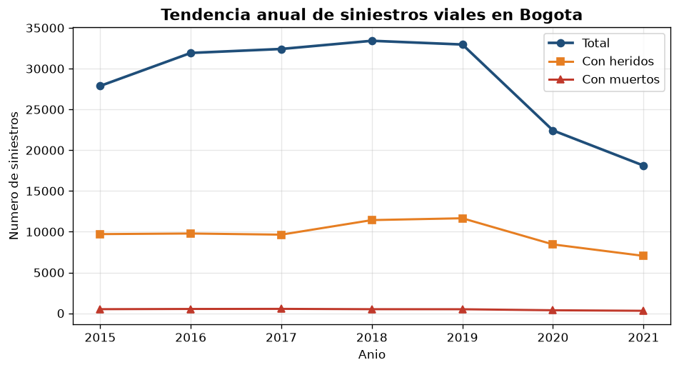
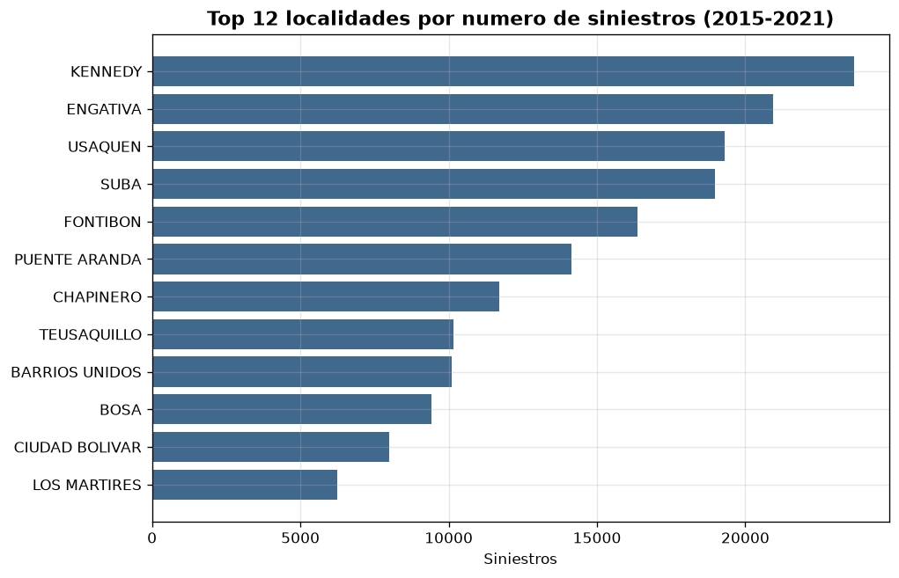
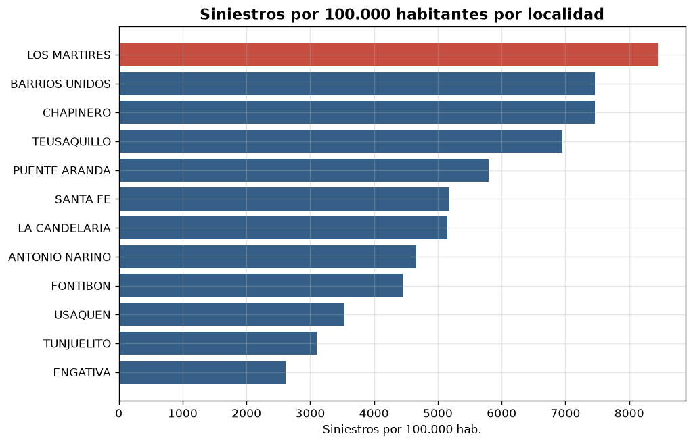
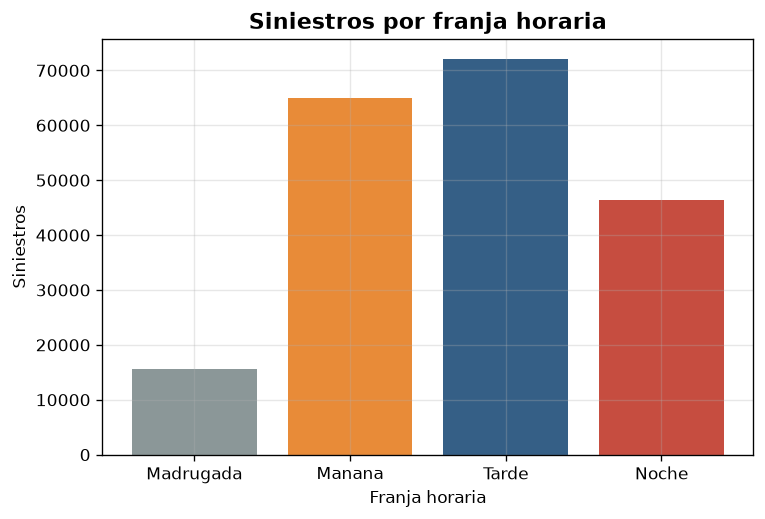
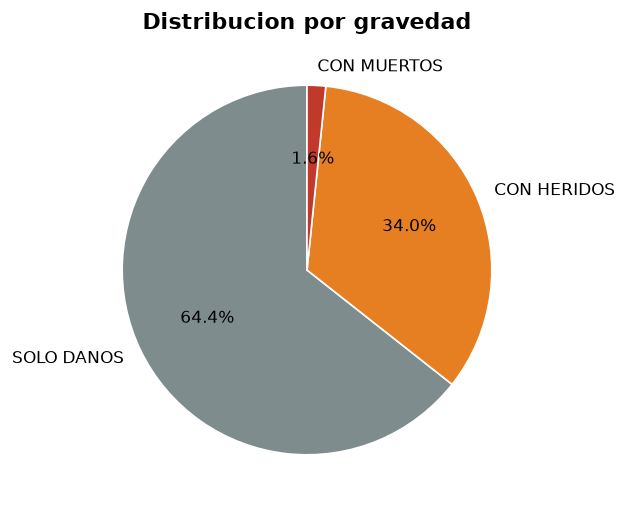
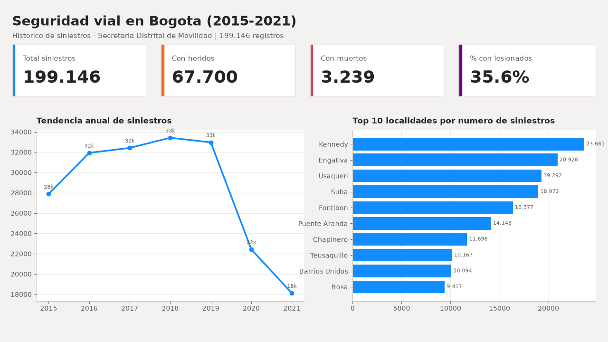
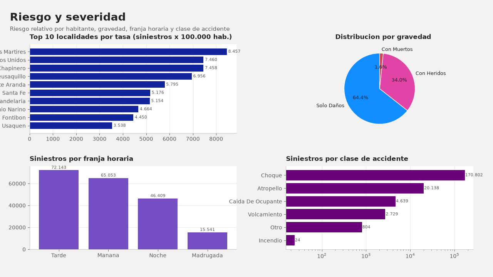

# Seguridad Vial en Bogotá — Analítica end-to-end (SQL + Python + Power BI)

> Proyecto de portafolio que integra **SQL, Python y Power BI** sobre datos abiertos
> reales de la Alcaldía de Bogotá para responder una pregunta de negocio:
> **¿dónde y cuándo concentrar los recursos de prevención de siniestros viales?**


---

## Abstract (English)

End-to-end analytics portfolio project combining **SQL, Python and Power BI** on
**199,146 road-crash records** (Bogotá open data, 2015–2021). It builds a
reproducible pipeline (download → ETL → star schema → KPIs → dashboard) and
delivers two business-priority mechanisms: **volume** and **risk per capita**,
plus a combined **priority index** by locality, temporal patterns and critical
corridors. Reproducible with `python src/run_all.py`.

---

## 1. Problema de negocio

**Persona (cliente):** Secretaría Distrital de Movilidad / aseguradora de
movilidad con un presupuesto de prevención limitado.

**Pregunta:** los siniestros viales no se distribuyen de forma uniforme en el
territorio ni en el tiempo. Intervenir "donde hay más casos" no siempre es
óptimo: una localidad pequeña y céntrica puede tener **mucho más riesgo por
habitante** que una grande y periférica.

**Objetivo:** construir un pipeline reproducible (dato crudo → modelo analítico →
KPIs → tablero) que permita:

1. Medir la evolución anual y la gravedad de los siniestros.
2. Distinguir **volumen** (¿dónde hay más?) de **riesgo relativo** (¿dónde es
   más peligroso por habitante?).
3. Priorizar localidades con un criterio de doble entrada (**índice de
   prioridad**).
4. Identificar patrones temporales (franja y día) y **puntos críticos**
   (corredores) para focalizar operativos.

## 2. Datos (datos abiertos de Bogotá)

| Dataset | Entidad | Periodo | Registros | Licencia | Enlace |
|---|---|---|---|---|---|
| Histórico Siniestros Bogotá D.C. | Secretaría Distrital de Movilidad (SDM) | 2015–2021 | 199.146 | CC-BY-4.0 | [portal](https://datosabiertos.bogota.gov.co/dataset/historico-siniestros-bogota-d-c) |
| Población en Bogotá D.C. por Localidad (2005–2035) | Secretaría Distrital de Salud (SDS) | 2005–2035 | 651 (agregada) | CC-BY-4.0 | [portal](https://datosabiertos.bogota.gov.co/dataset/poblacion-en-bogota-d-c-2005-2035) |

Los datos **no se versionan**: el pipeline los descarga automáticamente desde el
portal. Ver el [diccionario de datos](docs/diccionario_datos.md).

## 3. Arquitectura de la solución

```
                    +-------------------+
                    |  Datos abiertos   |
                    |      Bogotá       |
                    +---------+---------+
                              |  requests (descarga)
                              v
   data/raw/.......   +-------------------+
   siniestros.csv     |  download_data.py |
   poblacion.csv      +---------+---------+
                              |
                              v
                    +-------------------+      MODELO ESTRELLA
                    |      etl.py       |--->  fact_siniestros
                    |  limpieza + dims  |      dim_tiempo / dim_localidad
                    +---------+---------+      dim_gravedad / dim_clase
                              |                poblacion_localidad
                              v
                    +-------------------+      data/warehouse.db (SQLite)
                    |   warehouse.db    |----> data/processed/*.csv
                    +---------+---------+
                              |  SQL (sql/02_kpi_queries.sql)
                              v
                    +-------------------+      reports/figures/*.png
                    |   analytics.py    |----> data/processed/kpi_*.csv
                    +---------+---------+
                              |
                              v
                    +-------------------+
                    |     Power BI      |  tablero ejecutivo (PBIP + DAX)
                    +-------------------+
```

**Stack:** SQL (modelo estrella + consultas analíticas) · Python (ETL, KPIs y
visualización) · Power BI (tablero interactivo y modelo de datos).

## 4. Resultados clave (2015–2021)

Resumen de **199.146 siniestros**: **128.207 solo daños**, **67.700 con heridos**
y **3.239 con muertos**. El pico fue **2018 (33.418)**; el descenso de 2020–2021
refleja la caída de movilidad por la pandemia.

### 4.1 Volumen vs. riesgo por habitante

El **volumen** se concentra en localidades grandes: **Kennedy (23.661)**,
**Engativá (20.928)**, **Usaquén (19.292)** y **Suba (18.973)**. Pero el
**riesgo por 100.000 habitantes** es muy superior en el centro: **Los Mártires
(8.457)**, **Barrios Unidos (7.460)**, **Chapinero (7.458)** y **Teusaquillo
(6.956)**. Conclusión: **volumen y riesgo no coinciden**.





### 4.2 Índice de prioridad (criterio mixto)

Combinando el ranking de **volumen** y el de **tasa por habitante**
(`índice = rank_volumen + rank_riesgo`; menor = más prioritario), las localidades
que destacan en **ambos** criterios son:

| # | Localidad | Siniestros | Rank volumen | Tasa x100k | Rank riesgo |
|---|---|---|---|---|---|
| 1 | Chapinero | 11.696 | 7 | 7.458 | 3 |
| 2 | Puente Aranda | 14.143 | 6 | 5.795 | 5 |
| 3 | Barrios Unidos | 10.094 | 9 | 7.460 | 2 |
| 4 | Teusaquillo | 10.167 | 8 | 6.956 | 4 |
| 5 | Los Mártires | 6.250 | 12 | 8.457 | 1 |
| 6 | Usaquén | 19.292 | 3 | 3.538 | 10 |
| 7 | Kennedy | 23.661 | 1 | 2.295 | 13 |

> **Insight de negocio:** una estrategia basada solo en volumen subestima el
> riesgo en el centro. El índice combinado prioriza localidades céntricas
> (Chapinero, Puente Aranda, Barrios Unidos, Teusaquillo, Los Mártires) junto con
> las grandes (Kennedy, Engativá, Usaquén).

### 4.3 Patrón temporal y severidad

- Mayor concentración en **tarde** (72.143) y **mañana** (65.053).
- **Viernes** es el día más crítico (32.074); **domingo**, el menor (19.529).
- **CHOQUE** domina (170.802), seguido de **ATROPELLO** (20.138).
- La severidad (siniestros con lesionados) es mayor en el sur: **San Cristóbal
  (53,2%)**, **Rafael Uribe Uribe (52,2%)** y **Usme (49,9%)**.
- **Punto crítico:** KR 80 – CL 2 (Kennedy, 213 siniestros).




El análisis completo de hallazgos y recomendaciones está en
[`docs/informe.md`](docs/informe.md).

## 5. Tablero de Power BI

Entregado como **proyecto PBIP** (formato de texto versionable en Git), listo
para abrir en Power BI Desktop:

```
powerbi/SeguridadVialBogota/SeguridadVialBogota.pbip
```

Incluye el modelo estrella, 6 medidas DAX y dos páginas (Resumen ejecutivo y
Riesgo y severidad). Instrucciones en
[`powerbi/SeguridadVialBogota/README.md`](powerbi/SeguridadVialBogota/README.md).

**Página 1 — Resumen ejecutivo**



**Página 2 — Riesgo y severidad**



## 6. Cómo ejecutar

```bash
pip install -r requirements.txt
python src/run_all.py
```

Pasos individuales:

```bash
python src/download_data.py   # 1. descarga a data/raw
python src/etl.py             # 2. construye data/warehouse.db + data/processed
python src/analytics.py       # 3. genera KPIs (CSV) y figuras (PNG)
```

## 7. Estructura del repositorio

```
seguridad-vial-bogota/
├── src/
│   ├── config.py          # rutas, fuentes y catálogos
│   ├── download_data.py   # descarga los CSV del portal
│   ├── etl.py             # limpieza y modelo estrella -> SQLite
│   ├── analytics.py       # ejecuta el SQL, genera KPIs y figuras
│   └── run_all.py         # ejecuta todo el pipeline
├── sql/
│   ├── 01_schema.sql      # DDL del modelo estrella
│   └── 02_kpi_queries.sql # consultas analíticas (KPIs)
├── powerbi/
│   ├── SeguridadVialBogota/   # proyecto PBIP (modelo + tablero)
│   ├── guia_tablero.md        # construcción manual del tablero
│   └── medidas_dax.md         # medidas DAX
├── docs/
│   ├── informe.md             # informe de hallazgos de negocio
│   ├── diccionario_datos.md   # definición de tablas y campos
│   └── img/                   # capturas y vistas previas
├── data/                  # (generado) raw/, processed/, warehouse.db
├── reports/figures/       # (generado) gráficas del análisis
└── requirements.txt
```

## 8. Habilidades demostradas

- **ETL y calidad de datos:** ingesta de CSV, limpieza, normalización de
  localidades, manejo de fechas con zona horaria y valores nulos.
- **Modelado de datos:** esquema en estrella (tabla de hechos + dimensiones),
  claves subrogadas y tabla de población para tasas.
- **SQL analítico:** DDL, índices y KPIs con agregaciones y ratios.
- **DAX / Power BI:** medidas, relaciones y tablero con proyecto PBIP.
- **Análisis de negocio:** definición de KPIs, criterio de priorización y
  recomendaciones accionables.
- **Reproducibilidad:** pipeline de un comando, requisitos fijados y
  documentación.

## 9. Autor

**Juan Rojas** — GitHub: [@jdrojasp11](https://github.com/jdrojasp11)

> ¿Buscando talento en analítica de datos? Este repositorio demuestra un flujo
> completo de datos: de la fuente cruda al insight de negocio.

## 10. Licencia y atribución

Datos publicados por la Secretaría Distrital de Movilidad y la Secretaría
Distrital de Salud de Bogotá bajo licencia **CC-BY-4.0**. El código de este
repositorio se distribuye bajo licencia **MIT** (ver [`LICENSE`](LICENSE)).
